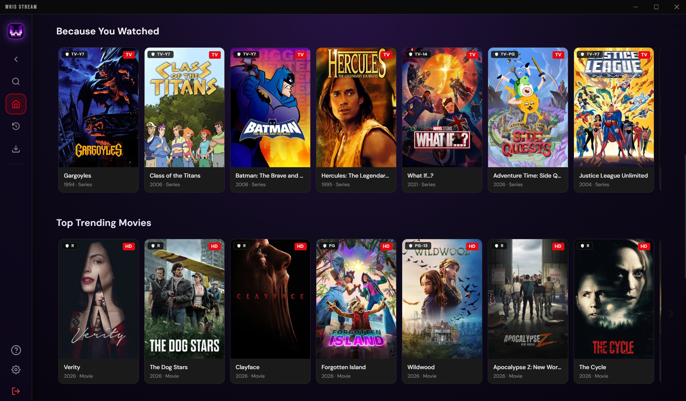

# WHIS STREAM

<p align="center">
  
</p>

<p align="center">
  <b>Modern Desktop Media Streaming Platform</b><br/>
  Featuring a Netflix-style cinematic browsing layout, frosted glass UI accents, dynamic purple themes, integrated ad and tracker blocking, and offline playback.
</p>

<p align="center">
  
</p>

---

## Overview

WHIS STREAM is a high-performance desktop application engineered for streaming movies, television series, and anime. Built on Electron and Vite, it delivers instant playback, automatic source failover, and a fluid desktop experience.

---

## Key Features

- **Netflix-Style Interface**: Cinematic billboard hero with dynamic metadata, match metrics, and horizontal slide-scrolling content rows.
- **Custom Glassmorphic Theme**: Deep purple dark mode with frosted glass panels, translucent surfaces, and subtle ambient glows.
- **Privacy & Ad-Blocking**: Built-in network-level blocking for third-party trackers, ad injection networks, and malicious redirects.
- **Offline Downloads**: High-speed integrated downloader with queue management for offline viewing.
- **Subtitle Integration**: Multi-source subtitle synchronization with customizable font styles and automatic language matching.
- **Anime Support**: Auto-skip intro and outro sequences powered by AniSkip API integration.
- **Hardware Acceleration**: Low-overhead memory management and hardware-accelerated video decoding.

---

## Getting Started

### Prerequisites

- Node.js (v18.0.0 or higher)
- npm

### Development Setup

```bash
# Clone the repository
git clone https://github.com/NamanGaonkar/WHIS-STREAM.git
cd WHIS-STREAM

# Install dependencies
npm install

# Run the app in development mode
npm start
```

### Packaging & Builds

To generate a standalone Windows installer:

```bash
npm run dist:win
```

Build outputs will be created under the `dist/` directory.

---

## Configuration

On first run, provide a TMDB Read Access Token to enable catalog discovery and metadata scraping. You can obtain a free API Read Access Token directly from [The Movie Database](https://www.themoviedb.org/settings/api).

---

## License

Distributed under the GNU General Public License v3.0 (GPL-3.0). See [LICENSE](LICENSE) for details.
